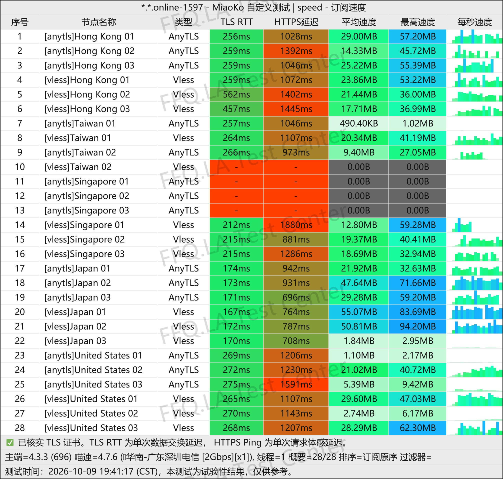
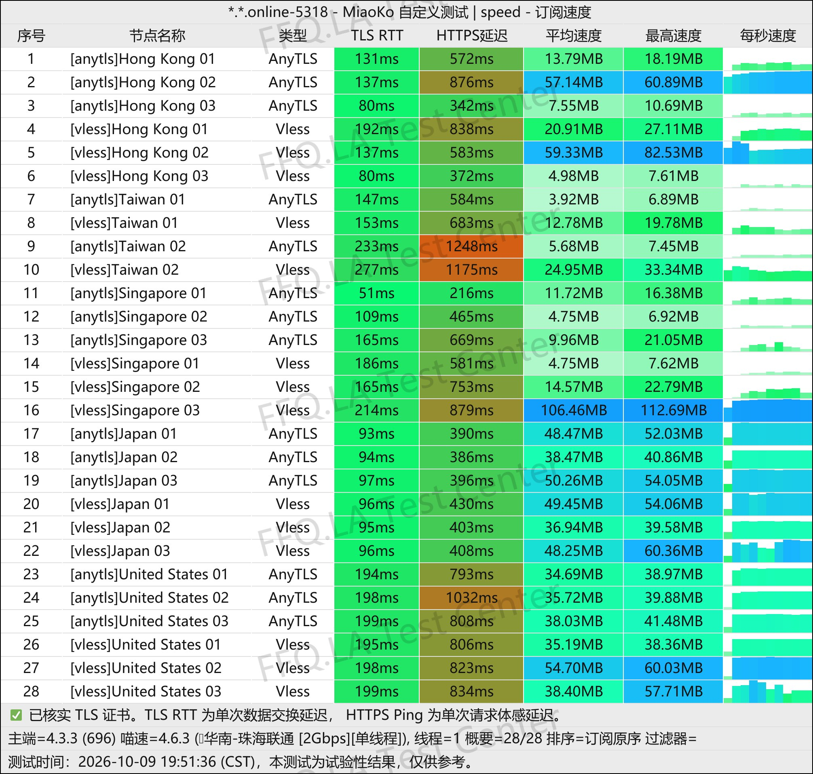
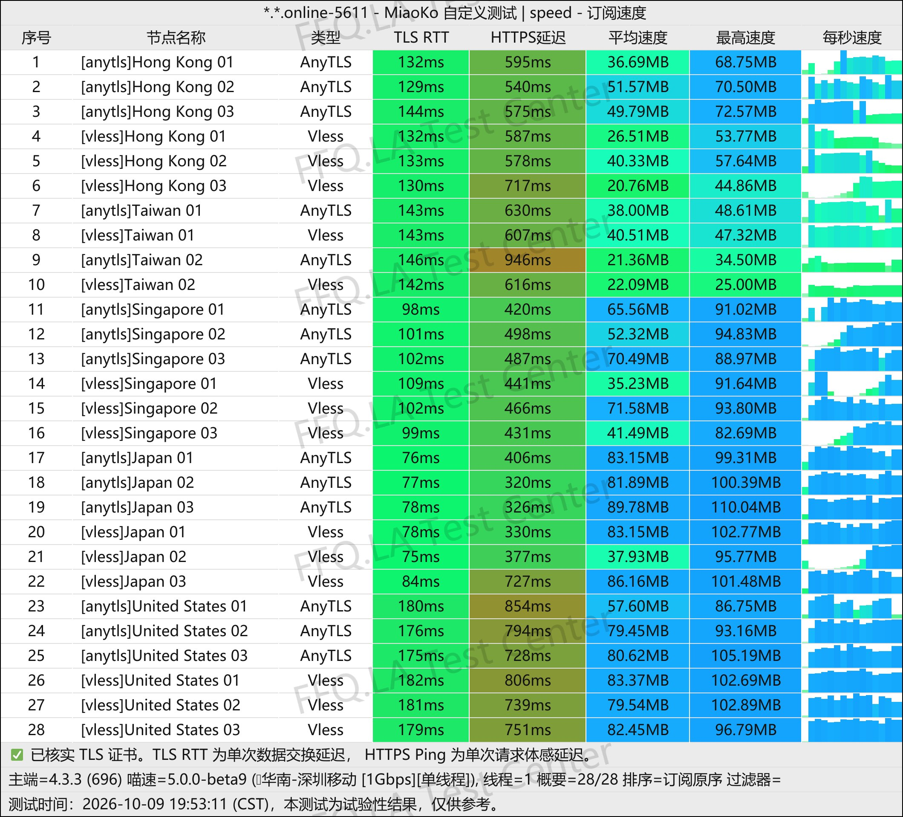
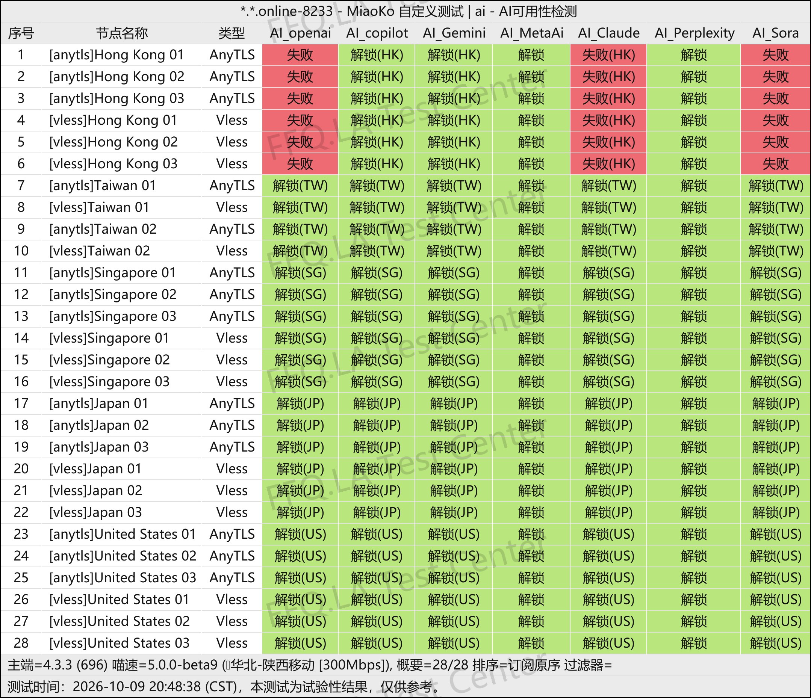
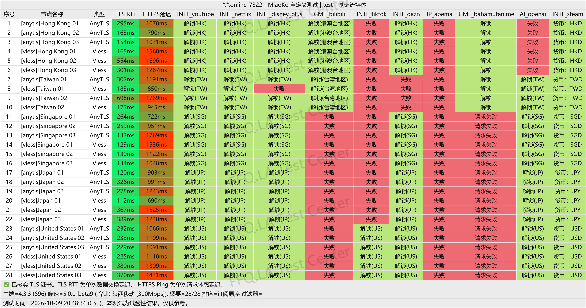

🇨🇳 [中文](README.md) | 🇺🇸 English | 🇷🇺 [Русский](README_RU.md) | 🇮🇷 [فارسی](README_FA.md)

# PingNetwork VPN Official Website (Updated November 11, 2026)

PingNetwork VPN Official Website</br>

Latest Address: [pingnetwork.org](https://to.iix.im/ping01)</br>
Official Address: [pingnetwork.de](https://to.iix.im/ping01)</br>

2026 Recommended VPN Services and Server Node Sharing: [https://github.com/jdnei/JiChangTuiJian](https://github.com/jdnei/JiChangTuiJian)</br>

## Telegram VPN Community #AD

[VPN Giveaway Group](https://331024.de/archives/choujiang)｜[VPN Discussion Group](https://331024.de/archives/choujiang)｜[VPN Trial Group](https://331024.de/archives/choujiang)</br>

[https://331024.de/archives/choujiang](https://331024.de/archives/choujiang)

## Invitation Code

```bash
MkEkJHrN
```

## Promo Code / Discount Code

`Expiration Date: None`

```bash
FFQ
```

## Introduction

PingNetwork VPN is a network acceleration service provider launched in 2026. It focuses on affordable direct-connection routes and uses protocols such as VLESS and AnyTLS. The service offers annual subscriptions and one-time data packages. With its lightweight and budget-friendly positioning, PingNetwork is suitable for everyday browsing, streaming entertainment, file downloads, and use as a backup VPN service.

## Advantages

PingNetwork VPN's main advantages are its low entry price and generous data allowances, making it attractive to users on a limited budget and those seeking a long-term backup VPN. Its nodes use relatively new protocols, including VLESS and AnyTLS. With relatively low network loads at present, connection speeds are generally good. Annual subscriptions and one-time data packages are also available to accommodate different needs, including occasional use and file downloads.

## Plans

| Plan | Data Allowance | Billing Cycle | Price | Simultaneous Devices | Bandwidth | Node Traffic Multiplier | Routes / Nodes | Features / Notes |
|---|---|---|---|---|---|---|---|---|
| Small Plan | 150GB / month | Annual subscription; resets monthly | ¥19 / year | 5 | Up to 3Gbps | 1.0× on all nodes | Low-latency connections across four networks; global nodes | Proprietary AI unlocking gateway; supports users in Xinjiang, Henan, and Fujian; claims to keep no node logs |
| Medium Plan | 300GB / month | Annual subscription; resets monthly | ¥38 / year | 5 | Up to 3Gbps | 1.0× on all nodes | Low-latency connections across four networks; global nodes | Proprietary AI unlocking gateway; supports users in Xinjiang, Henan, and Fujian; claims to keep no node logs |
| Large Plan | 500GB / month | Annual subscription; resets monthly | ¥66 / year | 5 | Up to 3Gbps | 1.0× on all nodes | Low-latency connections across four networks; global nodes | Proprietary AI unlocking gateway; supports users in Xinjiang, Henan, and Fujian; claims to keep no node logs |
| Unlimited-Time Plan | 1000GB (allocated once) | One-time purchase / No expiration | ¥68 | 5 | Up to 3Gbps | 1.0× on all nodes | Low-latency connections across four networks; global nodes | Proprietary AI unlocking gateway; supports users in Xinjiang, Henan, and Fujian; claims to keep no node logs; valid until the data allowance is exhausted |

## 📊 Performance Tests and Analysis

#### 1.1 China Telecom Speed Test During Evening Peak Hours

</br>

#### 1.2 China Unicom Speed Test During Evening Peak Hours

</br>

#### 1.3 China Mobile Speed Test During Evening Peak Hours

</br>

#### 2. AI Service Unlocking Report

</br>

#### 3. Streaming Service Unlocking Report

</br>

#### 4. Entry and Exit Node Analysis

</br>
