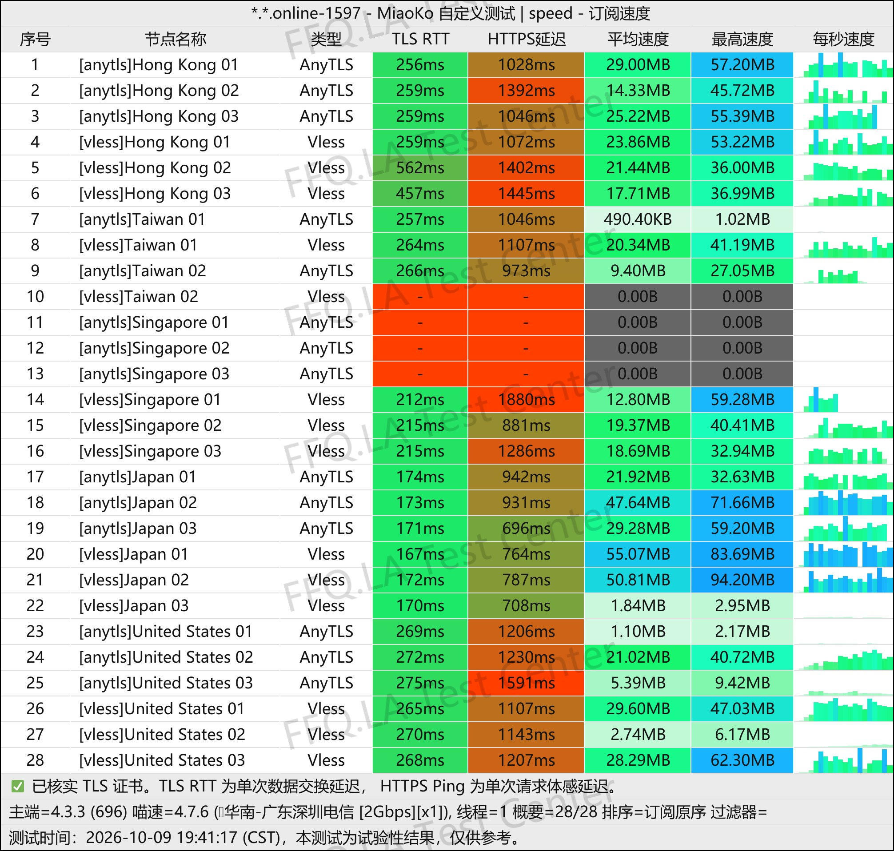
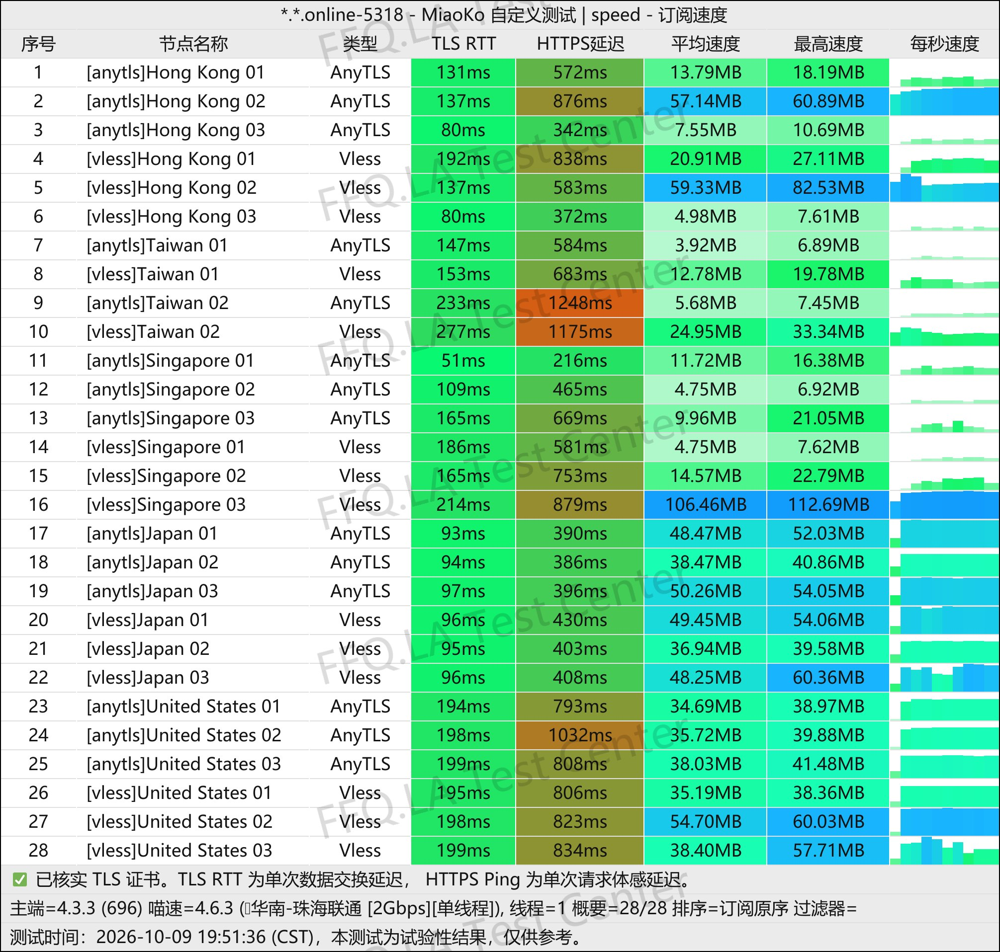
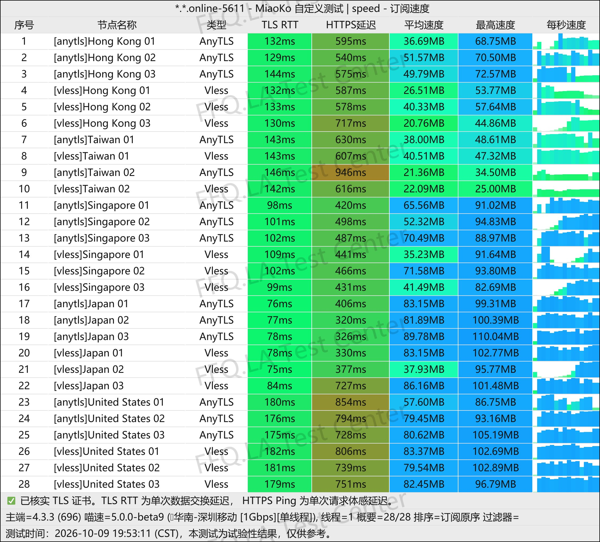
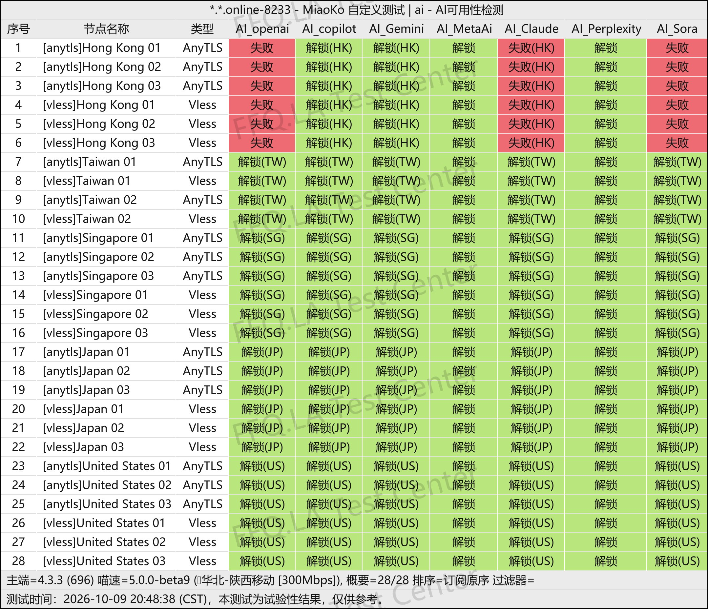
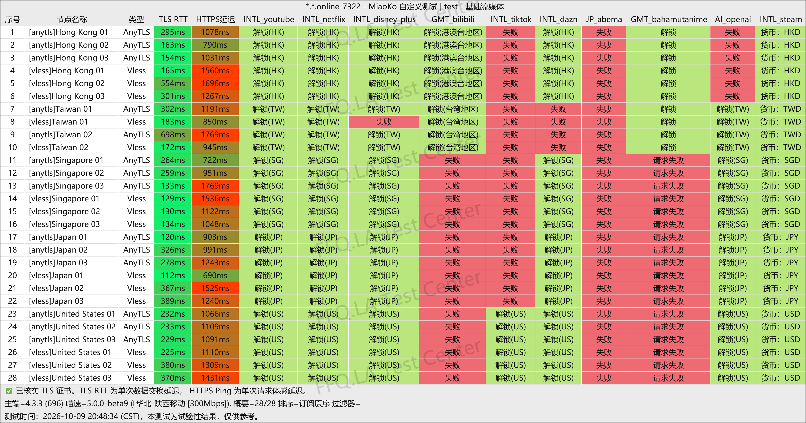

 🇨🇳 [中文](README.md) | 🇺🇸 [English](README_EN.md) | 🇷🇺 [Русский](README_RU.md) | 🇮🇷 فارسی

# آدرس رسمی PingNetwork VPN (به‌روزرسانی 5 نوامبر 2026)

وب‌سایت رسمی PingNetwork VPN</br>

جدیدترین آدرس: [pingnetwork.org](https://to.iix.im/ping01)</br>
آدرس رسمی: [pingnetwork.de](https://to.iix.im/ping01)</br>

معرفی بهترین سرویس‌های VPN و اشتراک‌گذاری نودهای پیشنهادی در سال 2026: [https://github.com/jdnei/JiChangTuiJian](https://github.com/jdnei/JiChangTuiJian)</br>

## انجمن تلگرام VPN و پیشنهادهای ویژه #AD

[گروه قرعه‌کشی VPN](https://331024.de/archives/choujiang)｜[گروه گفت‌وگوی VPN](https://331024.de/archives/choujiang)｜[گروه تست رایگان VPN](https://331024.de/archives/choujiang)</br>

[https://331024.de/archives/choujiang](https://331024.de/archives/choujiang)

## کد دعوت

```bash
MkEkJHrN
```

## کد تخفیف

`تاریخ انقضا: ندارد`

```bash
FFQ
```

## معرفی

PingNetwork VPN یک ارائه‌دهنده خدمات بهینه‌سازی و افزایش سرعت اتصال اینترنت است که در سال 2026 راه‌اندازی شد. این سرویس بر ارائه مسیرهای اتصال مستقیم با قیمت پایین تمرکز دارد و از پروتکل‌هایی مانند VLESS و AnyTLS استفاده می‌کند. اشتراک‌های سالانه و بسته‌های ترافیک یک‌باره از گزینه‌های خرید آن هستند. این سرویس با تمرکز بر استفاده سبک و مقرون‌به‌صرفه، برای مرور روزمره اینترنت، تماشای فیلم و سریال، دانلود فایل و استفاده به‌عنوان VPN پشتیبان مناسب است.

## مزایا

مهم‌ترین مزیت PingNetwork VPN قیمت اولیه پایین و حجم مناسب ترافیک در مقایسه با هزینه اشتراک است؛ به همین دلیل برای کاربران دارای بودجه محدود و افرادی که به یک VPN پشتیبان بلندمدت نیاز دارند، گزینه‌ای قابل‌توجه محسوب می‌شود.

نودهای این سرویس از پروتکل‌های نسبتاً جدید VLESS و AnyTLS استفاده می‌کنند. در حال حاضر، بار شبکه نسبتاً پایین است و سرعت اتصال عملکرد مناسبی دارد. همچنین، اشتراک‌های سالانه و بسته‌های ترافیک یک‌باره ارائه می‌شوند تا نیازهای مختلف، از استفاده گاه‌به‌گاه تا دانلود فایل، پوشش داده شوند.

## پلن‌ها

| نام پلن | حجم ترافیک | دوره پرداخت | قیمت | دستگاه‌های هم‌زمان | پهنای باند | ضریب مصرف ترافیک | مسیرها / نودها | ویژگی‌ها / توضیحات |
|---|---|---|---|---|---|---|---|---|
| پلن کوچک (小品) | 150GB در ماه | اشتراک سالانه؛ بازنشانی ماهانه | ¥19 در سال | 5 دستگاه | حداکثر 3Gbps | ضریب 1.0 برای تمام نودها | تأخیر کم در چهار شبکه؛ نودهای جهانی | درگاه اختصاصی رفع محدودیت سرویس‌های AI؛ پشتیبانی از کاربران سین‌کیانگ، هنان و فوجیان؛ ادعای عدم ثبت لاگ نودها |
| پلن متوسط (中品) | 300GB در ماه | اشتراک سالانه؛ بازنشانی ماهانه | ¥38 در سال | 5 دستگاه | حداکثر 3Gbps | ضریب 1.0 برای تمام نودها | تأخیر کم در چهار شبکه؛ نودهای جهانی | درگاه اختصاصی رفع محدودیت سرویس‌های AI؛ پشتیبانی از کاربران سین‌کیانگ، هنان و فوجیان؛ ادعای عدم ثبت لاگ نودها |
| پلن بزرگ (大品) | 500GB در ماه | اشتراک سالانه؛ بازنشانی ماهانه | ¥66 در سال | 5 دستگاه | حداکثر 3Gbps | ضریب 1.0 برای تمام نودها | تأخیر کم در چهار شبکه؛ نودهای جهانی | درگاه اختصاصی رفع محدودیت سرویس‌های AI؛ پشتیبانی از کاربران سین‌کیانگ، هنان و فوجیان؛ ادعای عدم ثبت لاگ نودها |
| پلن بدون محدودیت زمانی (不限时品品) | 1000GB (اختصاص یک‌باره) | خرید یک‌باره / بدون محدودیت زمانی | ¥68 | 5 دستگاه | حداکثر 3Gbps | ضریب 1.0 برای تمام نودها | تأخیر کم در چهار شبکه؛ نودهای جهانی | درگاه اختصاصی رفع محدودیت سرویس‌های AI؛ پشتیبانی از کاربران سین‌کیانگ، هنان و فوجیان؛ ادعای عدم ثبت لاگ نودها؛ قابل استفاده تا پایان حجم ترافیک |

## 📊 آزمایش عملکرد و تحلیل

#### 1.1 تست سرعت China Telecom در ساعات اوج مصرف شبانه

</br>

#### 1.2 تست سرعت China Unicom در ساعات اوج مصرف شبانه

</br>

#### 1.3 تست سرعت China Mobile در ساعات اوج مصرف شبانه

</br>

#### 2. گزارش دسترسی به سرویس‌های هوش مصنوعی

</br>

#### 3. گزارش رفع محدودیت سرویس‌های استریم

</br>

#### 4. تحلیل مسیرهای ورودی و خروجی نودها

</br>
