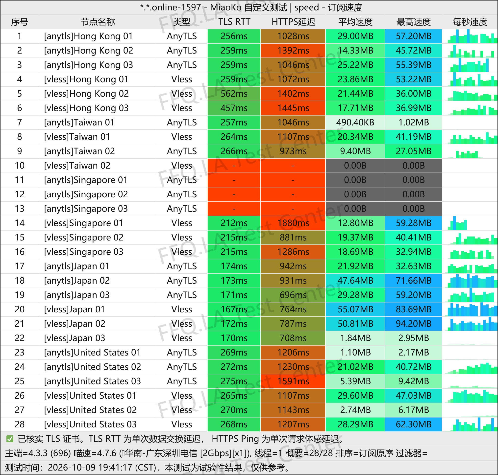
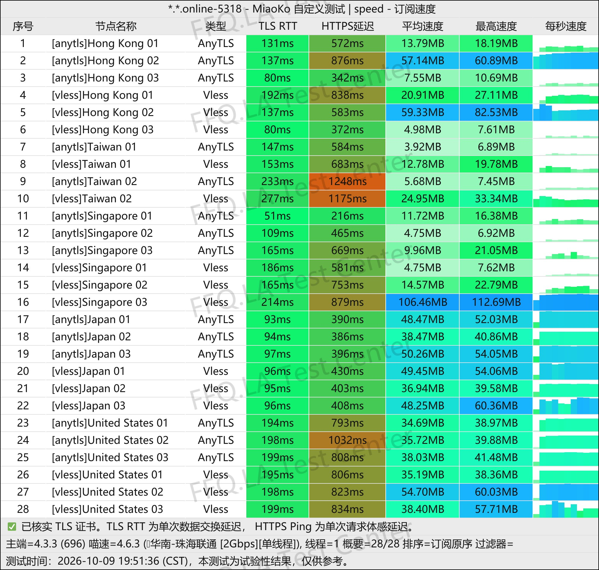
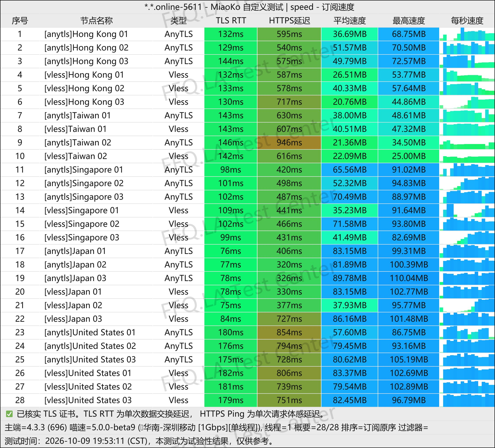
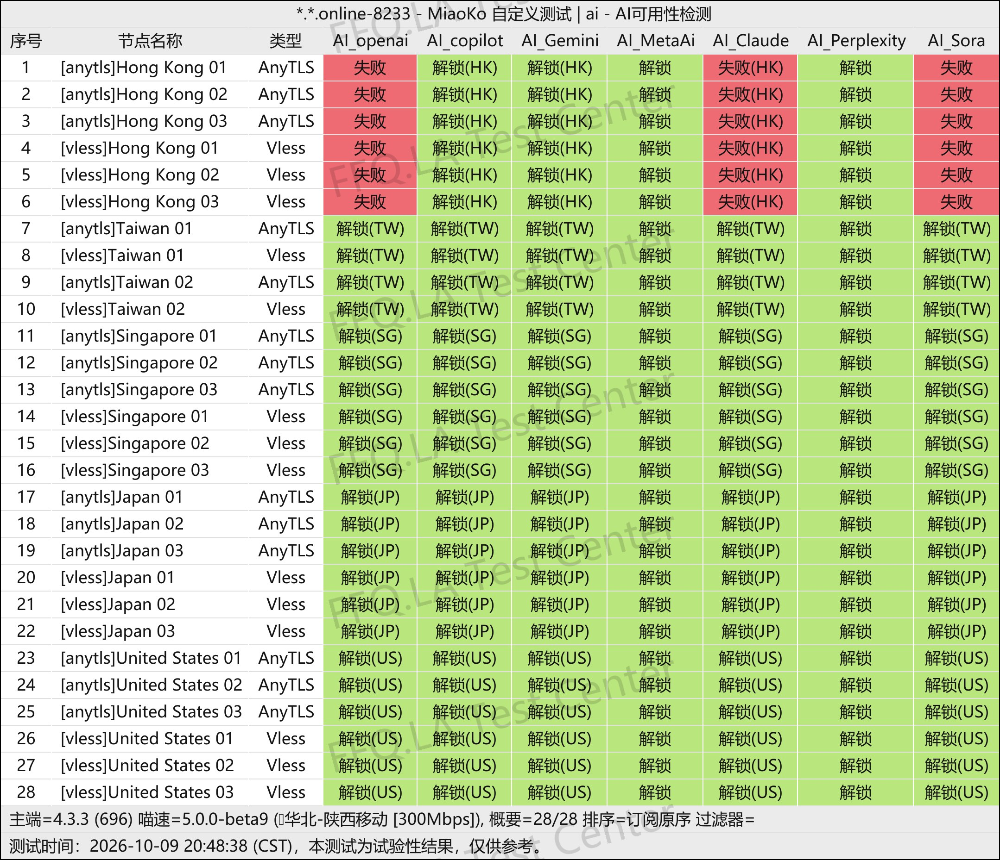
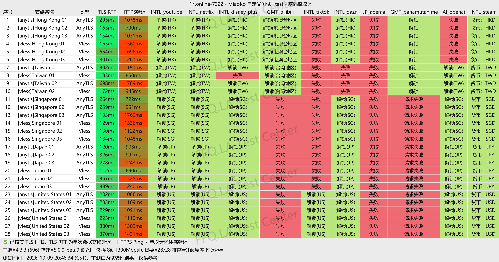

🇨🇳 [中文](README.md) | 🇺🇸 [English](README_EN.md) | 🇷🇺 Русский | 🇮🇷 [فارسی](README_FA.md)

# Официальный сайт PingNetwork VPN (обновлено 7 ноября 2026)

Официальный сайт PingNetwork VPN</br>

Актуальный адрес: [pingnetwork.org](https://to.iix.im/ping01)</br>
Официальный адрес: [pingnetwork.de](https://to.iix.im/ping01)</br>

Рекомендуемые VPN-сервисы и подборка серверных узлов на 2026 год: [https://github.com/jdnei/JiChangTuiJian](https://github.com/jdnei/JiChangTuiJian)</br>

## Telegram-сообщество VPN и специальные предложения #AD

[Группа розыгрышей VPN](https://331024.de/archives/choujiang)｜[Чат VPN](https://331024.de/archives/choujiang)｜[Группа тестирования VPN](https://331024.de/archives/choujiang)</br>

[https://331024.de/archives/choujiang](https://331024.de/archives/choujiang)

## Пригласительный код

```bash
MkEkJHrN
```

## Промокод / Код скидки

`Срок действия: без ограничений`

```bash
FFQ
```

## Описание

PingNetwork VPN — сервис ускорения и оптимизации интернет-соединения, запущенный в 2026 году. Основное направление работы — предоставление недорогих маршрутов с прямым подключением на базе современных протоколов VLESS и AnyTLS.

Сервис предлагает годовые подписки и разовые пакеты трафика. Благодаря доступным ценам и ориентации на повседневное использование PingNetwork подходит для просмотра веб-сайтов, потокового видео, скачивания файлов и использования в качестве резервного VPN.

## Преимущества

Главные преимущества PingNetwork VPN — низкая стоимость подписки и выгодные объёмы трафика. Сервис ориентирован на пользователей с ограниченным бюджетом, а также на тех, кому нужен недорогой резервный VPN для длительного использования.

Серверные узлы используют относительно новые протоколы VLESS и AnyTLS. В настоящее время нагрузка на сеть сравнительно невысокая, что положительно сказывается на скорости подключения.

Пользователям доступны годовые подписки и разовые пакеты трафика, позволяющие подобрать подходящий вариант как для периодического использования, так и для загрузки файлов.

## Тарифы

| Тариф | Объём трафика | Период оплаты | Цена | Одновременные устройства | Пропускная способность | Коэффициент расхода трафика | Маршруты / Узлы | Особенности / Примечания |
|---|---|---|---|---|---|---|---|---|
| Малый (小品) | 150GB / месяц | Годовая подписка; ежемесячное обновление трафика | ¥19 / год | 5 устройств | До 3Gbps | 1.0× для всех узлов | Низкая задержка в четырёх сетях; глобальные серверы | Собственный шлюз для доступа к AI-сервисам; поддержка пользователей из Синьцзяна, Хэнани и Фуцзяни; заявлено отсутствие журналов активности узлов |
| Средний (中品) | 300GB / месяц | Годовая подписка; ежемесячное обновление трафика | ¥38 / год | 5 устройств | До 3Gbps | 1.0× для всех узлов | Низкая задержка в четырёх сетях; глобальные серверы | Собственный шлюз для доступа к AI-сервисам; поддержка пользователей из Синьцзяна, Хэнани и Фуцзяни; заявлено отсутствие журналов активности узлов |
| Большой (大品) | 500GB / месяц | Годовая подписка; ежемесячное обновление трафика | ¥66 / год | 5 устройств | До 3Gbps | 1.0× для всех узлов | Низкая задержка в четырёх сетях; глобальные серверы | Собственный шлюз для доступа к AI-сервисам; поддержка пользователей из Синьцзяна, Хэнани и Фуцзяни; заявлено отсутствие журналов активности узлов |
| Без ограничения срока (不限时品品) | 1000GB (начисляется один раз) | Разовая покупка / Без ограничения срока | ¥68 | 5 устройств | До 3Gbps | 1.0× для всех узлов | Низкая задержка в четырёх сетях; глобальные серверы | Собственный шлюз для доступа к AI-сервисам; поддержка пользователей из Синьцзяна, Хэнани и Фуцзяни; заявлено отсутствие журналов активности узлов; действует до полного расходования трафика |

## 📊 Тестирование производительности и анализ

#### 1.1 Тест скорости China Telecom в вечерние часы пик

</br>

#### 1.2 Тест скорости China Unicom в вечерние часы пик

</br>

#### 1.3 Тест скорости China Mobile в вечерние часы пик

</br>

#### 2. Отчёт о доступности AI-сервисов

</br>

#### 3. Отчёт о разблокировке стриминговых сервисов

</br>

#### 4. Анализ входных и выходных маршрутов

</br>
